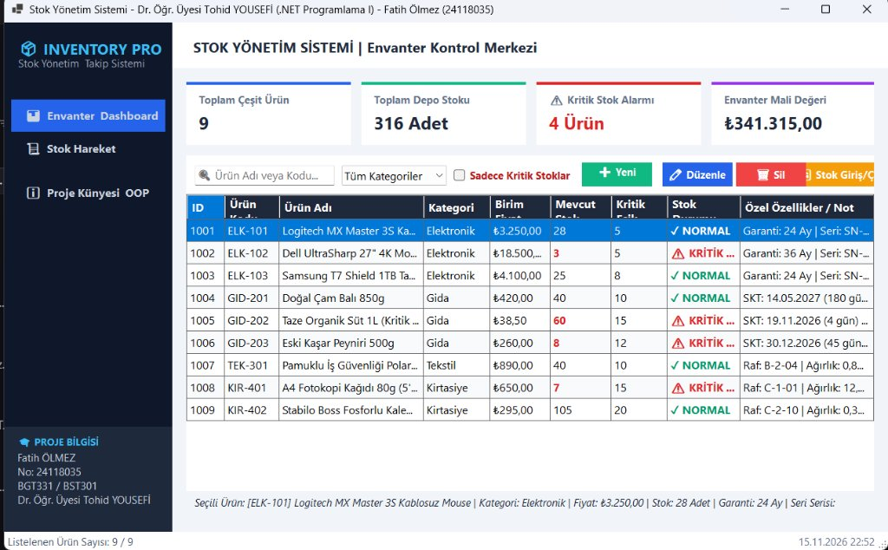
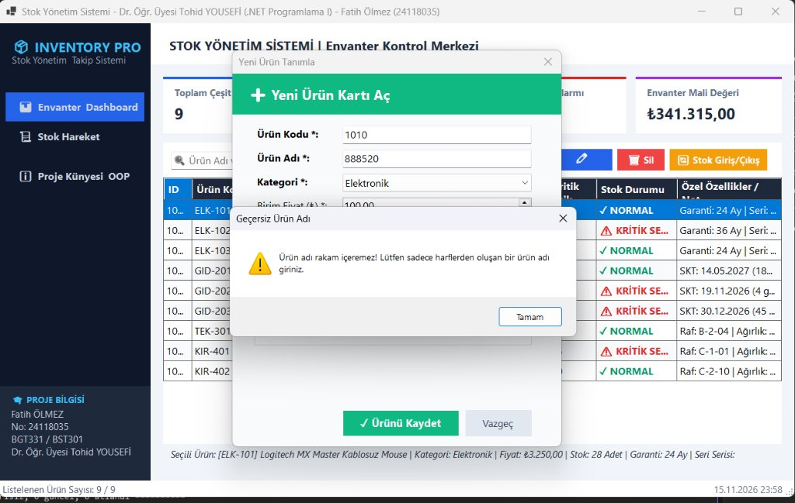
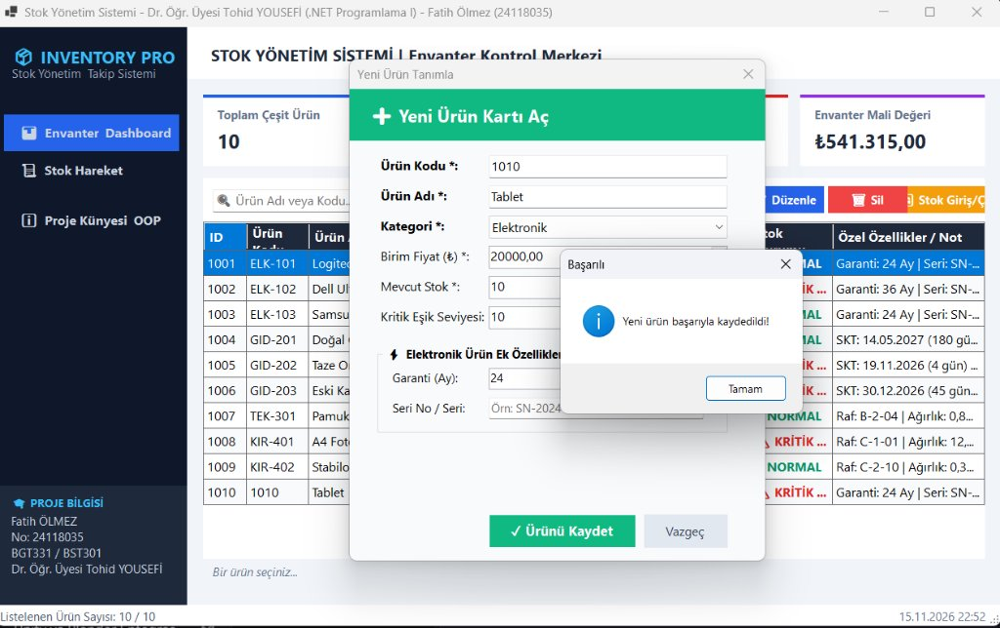
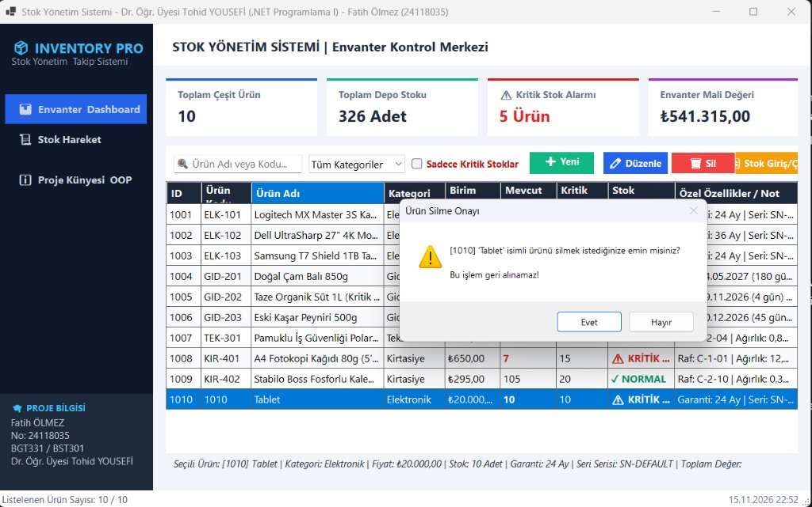
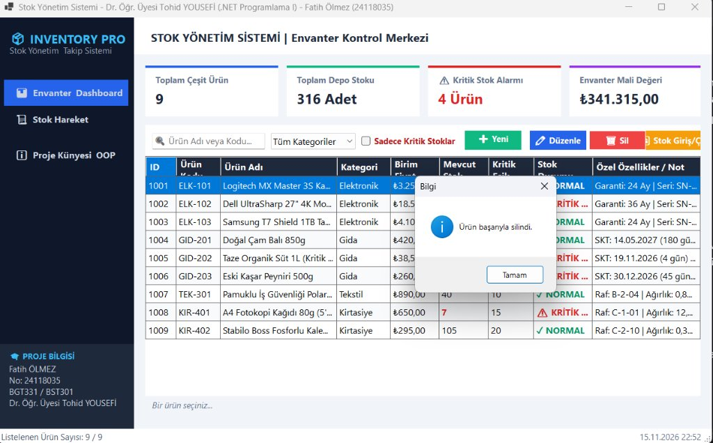

# .NET PROGRAMLAMA - I DERSİ PROJE ÖDEVİ TEKNİK RAPORU
## STOK YÖNETİM SİSTEMİ (INVENTORY MANAGEMENT SYSTEM)

---

### BÖLÜM 1: PROJE VE ÖĞRENCİ BİLGİLERİ (KAPAK)

* **Dersin Kodu:** BGT331 / BST301
* **Dersin Adı:** .NET Programlama - I
* **Öğretim Elemanı:** Dr. Öğr. Üyesi Tohid YOUSEFİ
* **Proje Adı:** Stok Yönetim Sistemi (Inventory Management System)
* **Öğrencinin Adı ve Soyadı:** Fatih ÖLMEZ
* **Öğrenci Numarası:** 24118035
* **Dönem:** 2026-2027 Güz Dönemi
* **Teslim Tarihi:** 20.11.2026

---

### BÖLÜM 2: PROJENİN AMACI VE KAPSAMI

#### 2.1. Amaç
Bu projenin temel amacı; Nesne Tabanlı Programlama (OOP) ilkelerini (Kapsülleme, Kalıtım, Çok Biçimlilik ve Soyutlama) C# programlama dili ve Windows Forms grafiksel arayüzü üzerinde işlevsel, modüler ve kurumsal bir mimariyle uygulamaktır.

#### 2.2. Kapsam ve Sınırlamalar
* Şartname doğrultusunda veritabanı veya SQL bağlantısı kullanılmamış; tüm veriler uygulama çalıştığı sürece bellekte (`in-memory`) generic koleksiyonlar (`List<T>`) üzerinde tutulmuştur.
* Uygulama; ürün tanımlama, listeleme, güncelleme, silme, stok girişi, stok çıkışı, çok kriterli filtreleme, kritik seviye takibi ve işlem denetim günlüğü (audit log) yeteneklerini kapsamaktadır.

---

### BÖLÜM 3: GELİŞTİRME ORTAMI VE TEKNOLOJİ BİLGİSİ

* **Geliştirme Ortamı (IDE):** Microsoft Visual Studio 2022
* **Hedef Platform / Çerçeve:** .NET Windows Desktop SDK / .NET Framework uyumlu C# Mimarisi
* **Programlama Dili:** C# 12.0
* **Arayüz Teknolojisi:** Windows Forms (WinForms) — Modern Flat UI ve Özel Stil Bileşenleri
* **Sürüm Kontrol Sistemi:** Git & GitHub (Öğretim üyesi `tohid.yousefi` collaborator olarak atanmıştır)

---

### BÖLÜM 4: UYGULAMANIN GENEL YAPISI VE TEMEL İŞLEVLERİ

Uygulama temel olarak 3 ana sekme ve 2 işlem dialogundan meydana gelmektedir:
1. **Envanter & Dashboard Ekranı:**
   * **Canlı KPI İstatistik Kartları:** Toplam ürün sayısı, toplam stok miktarı, kritik stok uyarısı ve envanter mali değeri anlık olarak hesaplanır.
   * **Akıllı DataGridView Tablosu:** Ürünlerin detayları, birim fiyatları, stok miktarları, polimorfik durum rozetleri ve sınıfa özel ek bilgileri gösterilir.
   * **Arama & Filtreleme Toolbarı:** Anlık metin araması, kategori seçimi ve "Sadece Kritik Stokları Göster" filtresi.
   * **İşlem Butonları:** Yeni Ürün Ekle, Seçileni Düzenle, Sil, Hızlı Stok Giriş/Çıkış.
2. **Stok Hareket Geçmişi (Audit Log):**
   * Yapılan her giriş ve çıkışın tarih-saati, işlem tipi, ürün kodu, miktarı, eski ve yeni stok miktarı ile işlem açıklamasını barındıran kronolojik denetim günlüğü.
3. **Proje Künyesi ve Mimari:**
   * OOP prensiplerinin teknik açıklamalarını ve sistem detaylarını içeren bilgilendirme paneli.

---

### BÖLÜM 5: SINIF VE NESNE TASARIMININ AÇIKLAMASI

Projede iş mantığı ile kullanıcı arayüzü birbirinden tamamen ayrılmış, katmanlı bir klasör yapısı oluşturulmuştur:

1. **`UrunBase` (Abstract Sınıf):** Tüm ürünlerin ortak kimlik, ad, fiyat ve stok özelliklerini barındıran soyut temel sınıftır.
2. **`FizikselUrun` (Model Sınıfı):** `UrunBase`'den türetilmiştir. Depolama raf konumu (`RafKonumu`) ve birim ağırlık (`AgirlikKg`) özelliklerine sahiptir.
3. **`BozulabilirUrun` (Model Sınıfı):** `UrunBase`'den türetilmiştir. Son Kullanma Tarihi (`SonKullanmaTarihi`) ve Saklama Sıcaklığı (`SaklamaSicakligi`) özelliklerini yönetir.
4. **`ElektronikUrun` (Model Sınıfı):** `UrunBase`'den türetilmiştir. Garanti süresi (`GarantiSuresiAy`) ve seri numarası (`SeriNoSerisi`) alanlarını içerir.
5. **`StokHareketi` (Model Sınıfı):** Gerçekleşen stok işlemlerinin hareket günlüğünü tutar.
6. **`StokManager` (Servis Sınıfı):** Ürünlerin bellekte saklanmasını, CRUD işlemlerini, arama motorunu ve stok giriş/çıkış iş kurallarını yönetir.
7. **`DemoDataService` (Servis Sınıfı):** Sistem açılışında zengin başlangıç verilerini sisteme yükler.

---

### BÖLÜM 6: OOP İLKELERİNİN PROJEDE UYGULANIŞI

#### 6.1. Kapsülleme (Encapsulation)
Sınıf değişkenleri `private` olarak tanımlanmış, dış dünyaya kontrollü Property yapıları ile açılmıştır.
```csharp
private decimal _birimFiyat;
public decimal BirimFiyat
{
    get => _birimFiyat;
    set
    {
        if (value < 0)
            throw new ArgumentException("Birim fiyat 0'dan küçük olamaz!");
        _birimFiyat = value;
    }
}
```

#### 6.2. Kalıtım (Inheritance)
`UrunBase` sınıfından 3 adet anlamlı alt sınıf türetilmiştir:
* `public class FizikselUrun : UrunBase`
* `public class BozulabilirUrun : UrunBase`
* `public class ElektronikUrun : UrunBase`

#### 6.3. Çok Biçimlilik (Polymorphism)
`KritikStokMu()` metodu `UrunBase` içerisinde `abstract` tanımlanmış ve her alt sınıfta özelleştirilmiştir:
* **Fiziksel Ürün:** `StokMiktari <= KritikStokSeviyesi` kuralını çalıştırır.
* **Bozulabilir Ürün:** Stok miktarı yüksek olsa dahi, eğer son kullanma tarihine 7 günden az kalmışsa (`(SonKullanmaTarihi - DateTime.Today).TotalDays <= 7`) ürün otomatik olarak **KRİTİK** kabul edilir.
* **Elektronik Ürün:** Uzun tedarik süreleri nedeniyle kritik eşiğe +2 adet emniyet payı eklenir.

Ayrıca `DetayliBilgiGetir()` ve `ToplamDegerHesapla()` sanal metotları (`virtual`) alt sınıflar tarafından `override` edilmiştir.

#### 6.4. Soyutlama (Abstraction)
* Soyut Sınıf: `public abstract class UrunBase`
* Arayüzler (Interfaces):
  * `IUrun`: Ürün kimlik ve finansal özellik sözleşmesi.
  * `IStokIslemleri`: Stok artırma, azaltma ve kritik seviye kontrolleri.
  * `ILoglanabilir`: Denetim günlüğüne formatlı log üretme yeteneği.

---

### BÖLÜM 7: WINDOWS FORMS BİLEŞENLERİ VE OLAYLAR

* **Panel & Splitter Düzeni:** Responsive, modern dashboard hissi veren sidebar ve içerik konteynerleri.
* **DataGridView:** Zebra renklendirme, `CellFormatting` olayı ile kritik stokların kırmızı/turuncu renk tonuyla otomatik olarak öne çıkarılması.
* **NumericUpDown:** Hatalı sayısal veri girişlerini (harf yazımı, negatif değerler) donanımsal olarak engelleyen kontroller.
* **DateTimePicker:** Gıda ürünleri için son kullanma tarihinin takvimden seçilmesi.
* **Olaylar (Events):**
  * `txtArama.TextChanged`: Kullanıcı klavyeden her harf yazdığında tablonun anlık filtrelenmesi.
  * `dgvUrunler.SelectionChanged`: Seçilen ürünün tüm detay ve maliyet bilgisinin alt barda özetlenmesi.
  * `dgvUrunler.DoubleClick`: Tablodaki ürüne çift tıklandığında doğrudan Hızlı Stok Hareketi penceresinin açılması.
  * `StokManager.VeriDegisti`: Veri tabanında (listede) herhangi bir değişiklik olduğunda arayüzün kendini yenilemesi için event-driven mimari.

---

### BÖLÜM 8: KOLEKSİYONLAR VE VERİ YÖNETİMİ

* Tüm ürün kayıtları `List<UrunBase>` generic koleksiyonunda tutulmaktadır. Çok biçimlilik sayesinde bu listede hem `FizikselUrun`, hem `BozulabilirUrun`, hem de `ElektronikUrun` nesneleri aynı çatı altında yönetilebilmektedir.
* Stok hareketleri `List<StokHareketi>` koleksiyonunda tutulur.
* LINQ sorguları (`Where`, `Any`, `Sum`, `OrderByDescending`) ile yüksek performanslı arama, filtreleme ve özet istatistik hesaplamaları gerçekleştirilmektedir.

---

### BÖLÜM 9: HATA YÖNETİMİ VE DEBUGGING ÖRNEĞİ

#### 9.1. Özel İstisna Sınıfları (Custom Exceptions)
* `YetersizStokException`: Depoda olandan fazla stok çıkışı yapılmak istendiğinde tetiklenir.
* `MukerrerUrunKoduException`: Var olan bir ürün koduyla ikinci kayıt eklenmek istendiğinde fırlatılır.
* `GecersizMiktarException`: Stok hareketlerinde sıfır veya negatif miktar girildiğinde fırlatılır.

#### 9.2. Debugging ve Try-Catch Örneği
```csharp
try
{
    _manager.StokCikisYap(seciliUrunKodu, miktar, aciklama);
    MessageBox.Show("Stok çıkışı başarılı!");
}
catch (YetersizStokException ex)
{
    MessageBox.Show(ex.Message, "Yetersiz Stok Uyarısı", MessageBoxButtons.OK, MessageBoxIcon.Warning);
}
```

---

### BÖLÜM 10: UYGULAMANIN ÇALIŞMA EKRAN GÖRÜNTÜLERİ

#### 10.1. Ana Dashboard ve Envanter Kontrol Merkezi
Uygulamanın açılış ekranı; üst panelde canlı hesaplanan 4 KPI istatistik kartı (Toplam Çeşit: 9, Toplam Stok: 316 Adet, Kritik Alarm: 4 Ürün, Toplam Envanter Değeri: ₺341.315,00) ve ürünlerin listelendiği akıllı DataGridView tablosunu göstermektedir.


#### 10.2. Hata Yönetimi ve Girdi Doğrulama (Rakam Girişi Uyarısı)
Kullanıcı ürün adı alanına geçersiz şekilde rakamlardan oluşan bir değer (`888520`) girdiğinde, hem UI hem de `UrunBase` kapsülleme kuralı devreye girerek kaydı durdurmakta ve kullanıcıya uyarı penceresi sunmaktadır.


#### 10.3. Yeni Ürün Tanımlama ve Başarılı Kayıt
Kullanıcı geçerli bir ürün adı (`Tablet`), birim fiyat (`20.000,00 ₺`) ve kategori girdiğinde yeni ürün başarıyla listeye eklenmekte; toplam ürün sayısı 9'dan 10'a, toplam envanter değeri ise ₺541.315,00'e anlık yükselmektedir.


#### 10.4. Ürün Silme Onay Penceresi
Listeden seçilen `1010` kodlu `Tablet` isimli ürün için silme butonuna tıklandığında, kullanıcının yanlışlıkla kayıt silmesini engellemek amacıyla onay modalı gösterilmektedir.


#### 10.5. Ürün Silme İşleminin Başarıyla Tamamlanması
Onay verilmesinin ardından ürün listeden başarıyla kaldırılmış, bilgi mesajı verilmiş ve toplam ürün sayısı tekrar 9'a dönmüştür.


---

### BÖLÜM 11: TEST SENARYOLARI (EN AZ 5 ADET)

| No | Test İşlemi / Girdisi | Beklenen Sonuç | Gerçekleşen Sonuç | Durum |
|---|---|---|---|---|
| **1** | Stokta 8 adet olan `GID-203` ürününden 15 adet stok çıkışı yapılması | `YetersizStokException` fırlatılmalı, kullanıcıya "Yetersiz stok! Mevcut: 8, İstenen: 15" uyarısı verilmeli ve stok değişmemelidir. | İşlem engellendi, uyarı mesajı gösterildi, stok 8 olarak kaldı. | **BAŞARILI** |
| **2** | Sistemde kayıtlı olan `ELK-101` koduyla yeni bir ürün eklenmeye çalışılması | `MukerrerUrunKoduException` fırlatılmalı, mükerrer kod uyarısı verilmeli ve kayıt reddedilmelidir. | Mükerrer ürün kodu uyarısı verildi, kayıt listeye eklenmedi. | **BAŞARILI** |
| **3** | Birim fiyat alanına negatif değer (-50 ₺) girilmesi | Property validasyonu veya NumericUpDown kontrolü negatif değere izin vermemelidir. | Kontrol negatif değer kabul etmedi, minimum 0.00 sınırlandı. | **BAŞARILI** |
| **4** | Stok adedi yeterli (60 adet) ancak SKT'sine 4 gün kalmış bozulabilir ürün (`GID-202`) kontrolü | Çok biçimli `KritikStokMu()` metodu sayesinde ürün tabloda kırmızı renkle ve "KRİTİK SEVİYE" rozetiyle listelenmelidir. | Ürün kritik stok sayacına eklendi ve tabloda kırmızı rozetle vurgulandı. | **BAŞARILI** |
| **5** | Stok giriş ekranında `KIR-402` ürününe +20 adet eklenmesi | Mevcut stok 85'ten 105'e yükselmeli, hareket günlüğüne "GİRİŞ" kaydı düşmeli, dashboard toplam stoku güncellenmelidir. | Stok anında 105 oldu, denetim günlüğüne işlem kaydedildi, KPI kartları güncellendi. | **BAŞARILI** |

---

### BÖLÜM 12: KARŞILAŞILAN SORUNLAR VE ÇÖZÜM YOLLARI

* **Sorun 1:** Farklı ürün kategorilerinin (örneğin son kullanma tarihi veya garanti süresi gibi) aynı form ekranında kullanıcıyı yormadan nasıl yönetileceği.
  * **Çözüm:** Kategori seçimine göre ilgili alanların (`GroupBox`) dinamik olarak görünür veya gizli olmasını sağlayan dinamik bir form tasarımı uygulandı.
* **Sorun 2:** WinForms DataGridView tablosunda kritik stok durumlarının kullanıcı tarafından anında fark edilmesini sağlamak.
  * **Çözüm:** `CellFormatting` olayı üzerinden polimorfik `KritikStokMu()` metodu çağrılarak satır bazlı akıllı renklendirme uygulandı.

---

### BÖLÜM 13: SONUÇ VE GENEL DEĞERLENDİRME

Bu projede, .NET Framework ve Visual Studio ortamı kapsamında Nesne Tabanlı Programlamanın 4 ana ilkesi başarıyla hayata geçirilmiştir. Arayüz ile iş kurallarının net biçimde ayrıldığı, güçlü hata kontrollerine sahip, modern görünümlü ve kurumsal standartlarda bir **Stok Yönetim Sistemi** geliştirilmiştir.
