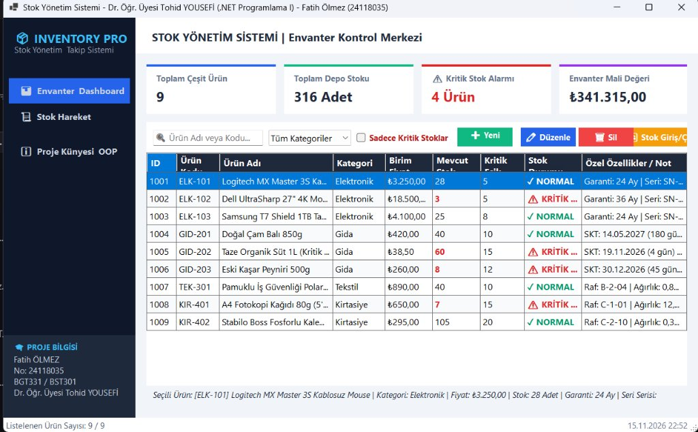
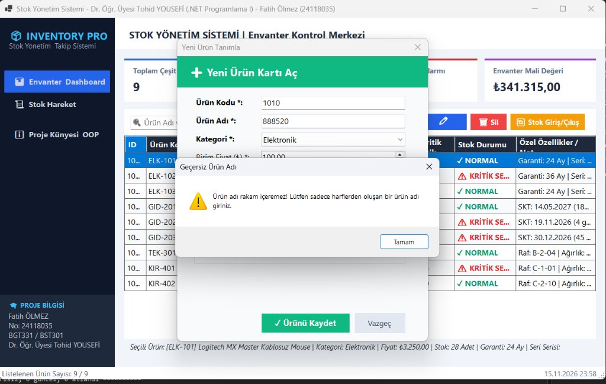
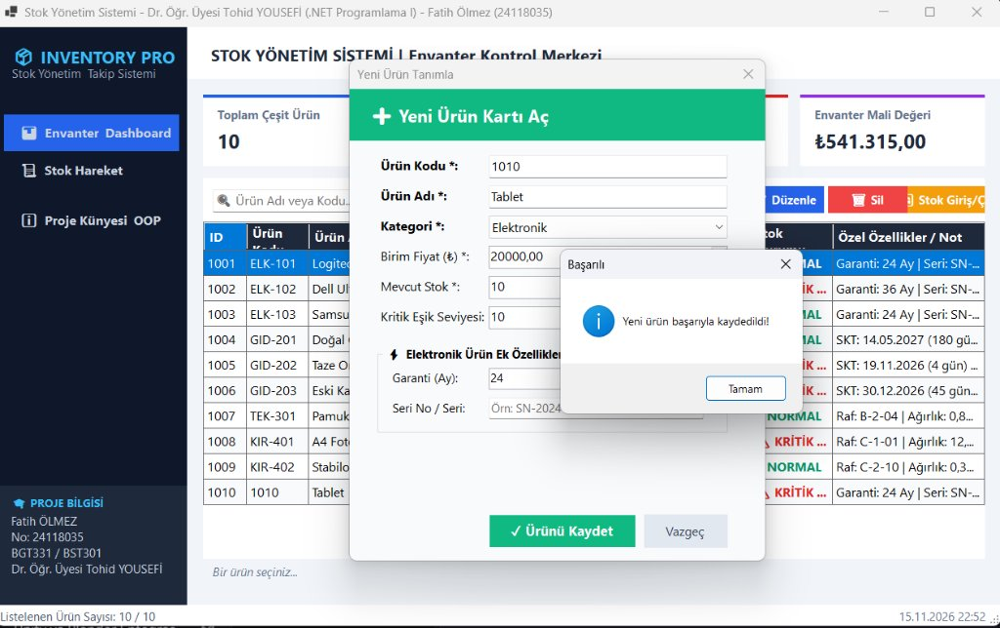
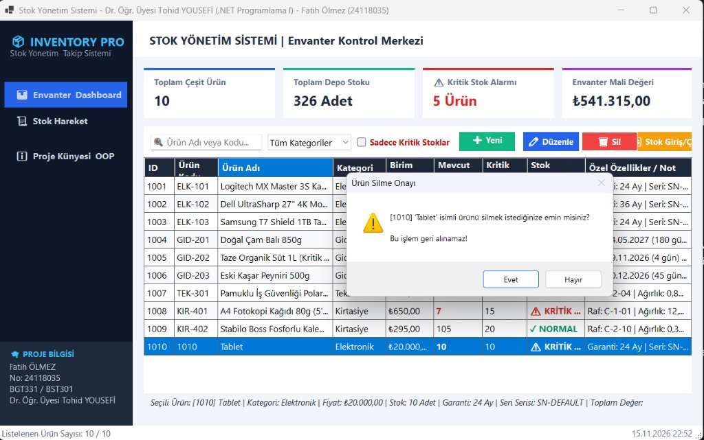
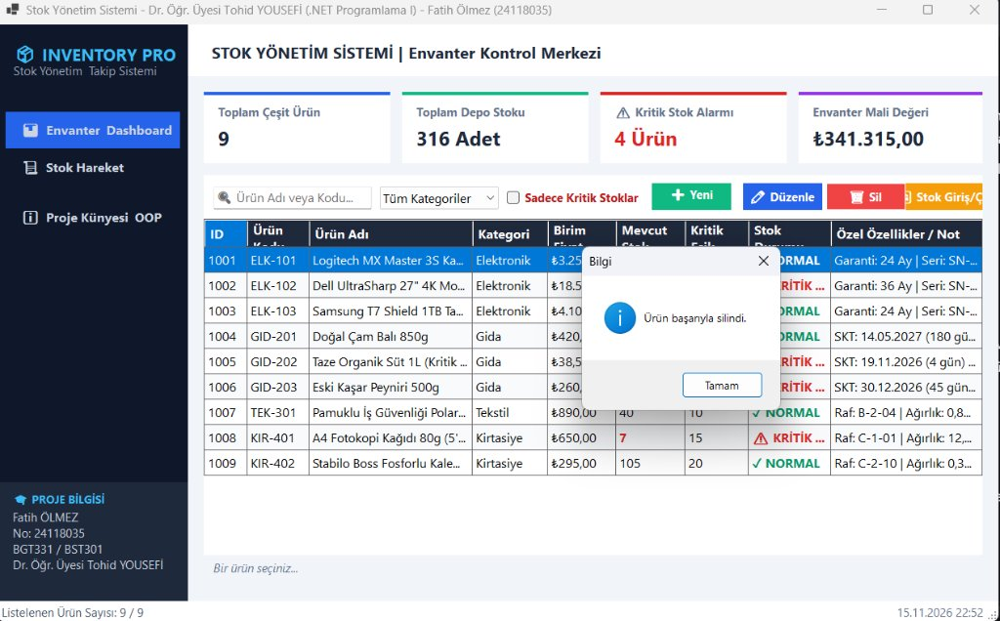

# Stok Yönetim Sistemi (Inventory Management System)

Bu proje, **Dr. Öğr. Üyesi Tohid YOUSEFİ** tarafından yürütülen **.NET Programlama - I (BGT331 / BST301)** dersi kapsamında geliştirilmiş kurumsal düzeyde bir masaüstü stok takip ve envanter yönetim yazılımıdır.

---

## 👨‍💻 Geliştirici Bilgileri
* **Öğrenci Adı Soyadı:** Fatih ÖLMEZ
* **Öğrenci Numarası:** 24118035
* **Ders Adı:** .NET Programlama - I
* **Ders Kodu:** BGT331 / BST301
* **Dönem:** 2026-2027 Güz Dönemi

---

## 📸 Uygulama Ekran Görüntüleri

### 1. Ana Dashboard & Envanter Kontrol Merkezi
Canlı hesaplanan 4 KPI göstergesi (Toplam Ürün, Toplam Stok, Kritik Stok Alarmı, Envanter Değeri) ve çok biçimli durum rozetleri içeren akıllı DataGridView envanter tablosu:


### 2. Hata Yönetimi ve Girdi Doğrulama (Rakam Girişi Uyarısı)
Ürün adına rakam girildiğinde sistemin hem kullanıcı arayüzü hem de OOP `UrunBase` kapsülleme kuralı seviyesinde kaydı engelleyip fırlattığı uyarı penceresi:


### 3. Yeni Ürün Tanımlama ve Başarılı Kayıt
Kullanıcı geçerli bir ürün adı (`Tablet`), birim fiyat (`20.000,00 ₺`) ve kategori girdiğinde yeni ürünün başarıyla listeye eklenmesi ve sayaçların anlık güncellenmesi:


### 4. Ürün Silme Onay Penceresi
Listeden seçilen ürünün yanlışlıkla silinmesini engellemek amacıyla sunulan onay dialogu:


### 5. Ürün Silme İşleminin Tamamlanması
Onay verilmesinin ardından ürünün listeden başarıyla kaldırılması ve sayaçların otomatik olarak güncellenmesi:


---

## 🎯 Projenin Amacı ve Temel Özellikleri
Bu projenin temel hedefi; modern **Nesne Tabanlı Programlama (OOP)** prensiplerini C# ve Windows Forms üzerinde eksiksiz biçimde uygulayarak, veritabanı bağımlılığı olmadan bellek içi (in-memory) koleksiyonlar üzerinde çalışan, estetik, kullanıcı dostu ve hataya dayanıklı bir **Stok Yönetim Sistemi** ortaya koymaktır.

### Temel Özellikler:
1. **Gelişmiş Dashboard:** Anlık toplam ürün adedi, toplam stok miktarı, kritik stok uyarıları ve toplam envanter mali değerini (₺) gösteren canlı KPI göstergeleri.
2. **Akıllı Envanter Tablosu:**
   * Çok biçimli (polymorphic) kritik stok tespiti.
   * Kritik seviyedeki ve son kullanma tarihi yaklaşan ürünlerin otomatik renklendirilmesi ve uyarı rozeti alması.
3. **Ürün Yönetimi (CRUD):** Benzersiz ürün kodu kontrolü, kategori bazlı dinamik form alanları (Elektronik, Gıda, Depo/Fiziksel).
4. **Hızlı Stok Hareketleri:** Kolay stok girişi ve stok çıkışı, miktar kontrolleri ve yetersiz stok koruması.
5. **Denetim Günlüğü (Audit Log):** Gerçekleşen her stok hareketinin (kim, ne zaman, ne kadar, önceki ve sonraki stok, işlem açıklaması) ayrı bir sekmede kronolojik olarak listelenmesi.
6. **Canlı Arama ve Çoklu Filtreleme:** Ada veya koda göre anında arama, kategoriye göre filtreleme ve tek tıkla sadece kritik stokları filtreleme.
7. **Tek Tıkla Demo Veri Yükleme:** Sistemi test etmek isteyen kullanıcılar için zengin örnek ürünler ve hareket kayıtları.

---

## 🛠️ Kullanılan Teknolojiler ve Geliştirme Ortamı
* **Programlama Dili:** C# (C# 12.0)
* **Geliştirme Çerçevesi:** .NET 8.0 Windows Desktop (WinForms) / .NET Framework uyumlu mimari
* **Geliştirme Ortamı (IDE):** Visual Studio 2022
* **Tasarım:** Modern Flat Dashboard UI (Segoe UI, özel durum rozetleri, KPI kartları)

---

## 🏗️ Nesne Tabanlı Programlama (OOP) Mimarisi
Proje, şartnamede ve rubrikte belirtilen tüm OOP ilkelerini tam puan alacak şekilde hayata geçirmiştir:

1. **Kapsülleme (Encapsulation):**
   * Sınıf alanları `private` erişim belirleyicileri ile gizlenmiştir (`_birimFiyat`, `_stokMiktari`, `_urunAdi` vb.).
   * Property `get` ve `set` bloklarında mantıksal doğrulama uygulanmıştır (negatif fiyat ve stok girişleri engellenmiştir).
2. **Kalıtım (Inheritance):**
   * Temel soyut sınıf: `UrunBase`
   * Türetilen sınıflar: `FizikselUrun`, `BozulabilirUrun`, `ElektronikUrun`.
3. **Çok Biçimlilik (Polymorphism):**
   * `KritikStokMu()` metodu her alt sınıfta `override` edilmiştir. Örneğin: `BozulabilirUrun` sınıfında stok adedi yeterli olsa dahi Son Kullanma Tarihine (SKT) 7 günden az kalan ürünler kritik duruma geçer. `ElektronikUrun` sınıfında tedarik süresi sebebiyle ek güvenlik payı uygulanır.
   * `DetayliBilgiGetir()` ve `ToplamDegerHesapla()` metotları her ürün sınıfı için polimorfik olarak biçimlendirilmiştir.
4. **Soyutlama (Abstraction):**
   * `UrunBase` (abstract class)
   * `IUrun` (ürün temel sözleşmesi)
   * `IStokIslemleri` (stok yönetim sözleşmesi)
   * `ILoglanabilir` (denetim günlüğü sözleşmesi)

---

## 📂 Kaynak Kod Klasör Yapısı
```text
InventoryManagement/
├── Enums/
│   ├── UrunKategorisi.cs      # Elektronik, Gıda, Tekstil, Kırtasiye, Diğer
│   └── IslemTipi.cs           # Giris, Cikis
├── Interfaces/
│   ├── IUrun.cs               # Temel ürün arayüzü
│   ├── IStokIslemleri.cs      # Stok giriş/çıkış ve kritik seviye arayüzü
│   └── ILoglanabilir.cs       # Hareket günlüğü loglama arayüzü
├── Exceptions/
│   ├── YetersizStokException.cs
│   ├── MukerrerUrunKoduException.cs
│   └── GecersizMiktarException.cs
├── Models/
│   ├── UrunBase.cs            # Soyut temel ürün sınıfı
│   ├── FizikselUrun.cs        # Raf ve ağırlık özellikleri barındıran alt sınıf
│   ├── BozulabilirUrun.cs     # SKT ve saklama sıcaklığı olan alt sınıf
│   ├── ElektronikUrun.cs      # Garanti ve seri no içeren alt sınıf
│   └── StokHareketi.cs        # Stok hareket günlüğü modeli
├── Services/
│   ├── StokManager.cs         # İş mantığı, in-memory List<T> yönetimi, filtreleme
│   └── DemoDataService.cs     # Zengin örnek veri tohumlayıcı
├── Forms/
│   ├── MainForm.cs            # Modern ana dashboard ve yönetim arayüzü
│   ├── FormUrunEkleDuzenle.cs # Yeni ürün ekleme ve düzenleme dialogu
│   └── FormStokIslem.cs       # Hızlı stok giriş ve çıkış dialogu
└── Program.cs                 # Uygulama başlangıç noktası
```

---

## 🚀 Projeyi Çalıştırma Adımları

### Seçenek 1: Visual Studio Üzerinden
1. `01_SourceCode/InventoryManagement.sln` dosyasını Visual Studio ile açınız.
2. Çözümü derleyiniz (`Build -> Build Solution` veya `Ctrl+Shift+B`).
3. `F5` tuşuna basarak veya `Start / Başlat` butonuna tıklayarak uygulamayı çalıştırınız.

### Seçenek 2: Doğrudan Çalıştırılabilir Çıktı (.exe)
1. `02_Application/` klasörüne giriniz.
2. `InventoryManagement.exe` dosyasına çift tıklayarak sistemi derlemeye gerek kalmadan anında başlatabilirsiniz.

---

## 🔗 GitHub ve Collaborator Bilgisi
* **Repository:** `https://github.com/FatihOlmez/24118035_FatihOlmez_InventoryManagement` (Private)
* **Collaborator:** `tohid.yousefi` (Öğretim Elemanı davet edilmiştir)
