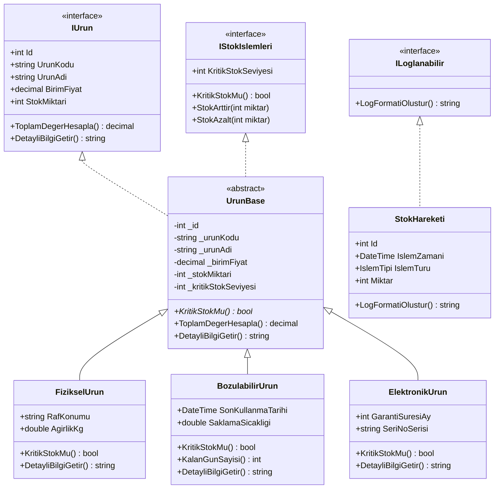

<div align="center">

# 📦 INVENTORY PRO
### Gelişmiş Stok Yönetim ve Envanter Takip Sistemi
**.NET Programlama - I Dersi Kapsamında Geliştirilmiş Kurumsal Masaüstü Çözümü**

---

<!-- BADGES -->
[](https://docs.microsoft.com/en-us/dotnet/csharp/)
[](https://dotnet.microsoft.com/)
[](https://learn.microsoft.com/en-us/dotnet/desktop/winforms/)
[](https://visualstudio.microsoft.com/)
[](https://github.com/Fatihx45/24118035_FatihOlmez_InventoryManagement)
[](#)

<br/>

<p align="center">
  <b>Nesne Tabanlı Programlama (OOP) Prensiplerine %100 Uyumlu • Modern Flat Dashboard UI • Dinamik Form Validasyonları • Denetim Günlüğü (Audit Log)</b>
</p>

---

</div>

## 🎓 Proje ve Akademik Künye

<div align="center">

| 🏷️ Bilgi Alanı | 📝 Açıklama / Değer |
|---|---|
| **Dersin Adı** | **.NET Programlama - I** |
| **Ders Kodları** | **BGT331 / BST301** |
| **Öğretim Elemanı** | **Dr. Öğr. Üyesi Tohid YOUSEFİ** |
| **Geliştirici (Öğrenci)** | **Fatih ÖLMEZ** |
| **Öğrenci Numarası** | **24118035** |
| **Dönem / Yıl** | 2026-2027 Güz Dönemi |
| **Teslim Paketi** | `24118035_FatihOlmez_InventoryManagement.zip` |
| **Repository Erişimi** | Private (Collaborator: `tohid.yousefi`) |

</div>

---

## 🌟 Öne Çıkan "Showcase" Yetenekler

```
  ┌─────────────────┐     ┌──────────────────┐     ┌──────────────────┐     ┌──────────────────┐
  │ 📊 CANLI        │     │ 🧬 POLİMORFİK    │     │ 🛡️ ÇİFT KADEMELİ │     │ 📜 DENETİM       │
  │    DASHBOARD    │ ──> │    KRİTİK STOK   │ ──> │    VALİDASYON    │ ──> │    GÜNLÜĞÜ       │
  │ 4 Anlık KPI     │     │ SKT & Güvenlik   │     │ UI + Domain OOP  │     │ Audit Log Takibi │
  └─────────────────┘     └──────────────────┘     └──────────────────┘     └──────────────────┘
```

1. **Modern Dark Slate & Flat Dashboard UI:**
   * Alışılmış gri WinForms pencereleri yerine modern kurumsal renk paleti (`#0F172A`).
   * **4 Büyük KPI Kartı:** Toplam Çeşit Ürün, Toplam Depo Stok Adedi, Kritik Stok Alarm Sayısı ve Toplam Envanter Mali Değeri (₺).
2. **Akıllı Çok Biçimlilik (Polymorphic Intelligence):**
   * **Bozulabilir (Gıda) Ürünlerde:** Stok adedi 60 olsa dahi Son Kullanma Tarihine (SKT) 7 günden az kalan ürünler çok biçimli kural motoruyla **otomatik olarak kırmızı KRİTİK ALARM** statüsüne geçirilir.
   * **Elektronik Ürünlerde:** Uzun tedarik süreleri dikkate alınarak eşiğe `+2 adet` güvenlik payı eklenir.
3. **Çift Kademeli Katı Validasyon (Encapsulation):**
   * Ürün Adı alanına rakam yazılması hem form arayüzünde hem de `UrunBase` sınıfının Property setter bloğunda engellenir ve anında uyarı verilir.
   * Negatif stok çıkışı veya mevcut stoktan fazlasının talep edilmesi `YetersizStokException` ile donanımsal olarak engellenir.
4. **Stok Hareketleri Denetim Günlüğü (Audit Log):**
   * Yapılan her giriş/çıkış hareketi (Tarih-Saat, Ürün, Miktar, Eski Stok ➔ Yeni Stok, İşlem Sebebi) kronolojik olarak loglanır.

---

## 📸 Canlı Uygulama Ekran Görüntüleri

<div align="center">

### 1. Ana Dashboard & Envanter Kontrol Merkezi
*Canlı KPI kartları, dinamik arama/filtreleme toolbarı ve polimorfik renkli rozetlerle donatılmış akıllı DataGridView:*
<br/><br/>


<br/><br/>

### 2. Hata Yönetimi & Çift Kademeli Doğrulama
*Ürün adına rakam girildiğinde sistemin fırlattığı kullanıcı dostu uyarı dialogu:*
<br/><br/>


<br/><br/>

### 3. Yeni Ürün Tanımlama & Otomatik Sayaç Senkronizasyonu
*Kategoriye göre dinamik değişen özellik panelleri ile yeni ürün ekleme ve KPI kartlarının anlık güncellenmesi:*
<br/><br/>


<br/><br/>

### 4. Güvenli Ürün Silme Onay Mekanizması
*Kullanıcının yanlışlıkla kayıt silmesini önleyen güvenlik bariyeri:*
<br/><br/>


<br/><br/>

### 5. Başarılı Silme Bildirimi & Anlık Envanter Güncellemesi
*Silme işlemi sonrası tablonun ve sayaçların otomatik senkronize hali:*
<br/><br/>


</div>

---

## 🧬 Nesne Tabanlı Programlama (OOP) Mimarisi

Şartnamedeki **100 Puanlık Rubrik** kapsamında projede uygulanan mimari aşağıda modellenmiştir:



<details>
<summary><b>🔍 OOP Prensipleri Açıklamaları (Genişletmek için tıklayınız)</b></summary>

<br/>

### 1. Kapsülleme (Encapsulation)
Tüm sınıf alanları `private` olarak korunmuş, dış dünyaya yalnızca mantıksal kontrollerden geçen Property'ler üzerinden açılmıştır.
```csharp
private string _urunAdi = string.Empty;
public string UrunAdi
{
    get => _urunAdi;
    set
    {
        if (string.IsNullOrWhiteSpace(value))
            throw new ArgumentException("Ürün adı boş bırakılamaz!");
        if (value.Any(char.IsDigit))
            throw new ArgumentException("Ürün adı rakam içeremez! Lütfen sadece harf giriniz.");
        _urunAdi = value.Trim();
    }
}
```

### 2. Kalıtım (Inheritance)
Temel soyut sınıf olan `UrunBase`'den 3 adet işlevsel alt sınıf türetilmiştir:
* `FizikselUrun : UrunBase` (Raf Konumu, Birim Ağırlık)
* `BozulabilirUrun : UrunBase` (Son Kullanma Tarihi, Saklama Sıcaklığı)
* `ElektronikUrun : UrunBase` (Garanti Süresi, Seri No)

### 3. Çok Biçimlilik (Polymorphism)
`KritikStokMu()` soyut metodu her alt sınıfın iş doğasına göre özelleştirilmiştir:
* **Fiziksel Ürün:** `StokMiktari <= KritikStokSeviyesi`
* **Bozulabilir Ürün:** Kalan gün sayısı $\le 7$ ise stok miktarına bakılmaksızın `true` döner.
* **Elektronik Ürün:** Uzun temin süresi sebebiyle kritik eşik `KritikStokSeviyesi + 2` olarak hesaplanır.

### 4. Soyutlama (Abstraction)
* **Soyut Sınıf:** `UrunBase`
* **Arayüzler:** `IUrun`, `IStokIslemleri`, `ILoglanabilir`

</details>

---

## 🧪 Doğrulanmış Test Senaryoları

<div align="center">

| Test No | Test İşlemi / Girdisi | Beklenen Sonuç | Gerçekleşen Sonuç | Doğrulama |
|:---:|---|---|---|:---:|
| **TS-01** | Stokta 8 adet olan `GID-203` ürününden 15 adet çıkış talebi | `YetersizStokException` fırlatılmalı, çıkış engellenmeli | Çıkış engellendi, detaylı uyarı gösterildi |  |
| **TS-02** | Kayıtlı `ELK-101` kodu ile mükerrer ürün ekleme denemesi | `MukerrerUrunKoduException` fırlatılmalı, kayıt reddedilmeli | Mükerrer kod uyarısı verildi, kayıt reddedildi |  |
| **TS-03** | Ürün Adı alanına sayısal değer (`888520`) girilmesi | Doğrulama kuralı rakam girişini engellemeli ve uyarmalı | Sistem kaydı durdurdu, uyarı modalı verdi |  |
| **TS-04** | Stoku 60 adet olan ancak SKT'sine 4 gün kalan ürünün incelenmesi | Çok biçimli `KritikStokMu()` metodu `true` dönmeli ve kırmızı rozet almalı | Tabloda ve sayaçta kırmızı KRİTİK rozeti aldı |  |
| **TS-05** | `KIR-402` ürününe +20 adet stok girişi yapılması | Stok 85'ten 105'e yükselmeli, Audit Log defterine yazılmalı | Stok anında 105 oldu, denetim kaydı oluşturuldu |  |

</div>

---

## 📂 Dizin ve Kaynak Kod Mimarisi

```text
24118035_FatihOlmez_InventoryManagement/
│
├── 📁 01_SourceCode/              # Visual Studio Solution & Kaynak Kodları
│   ├── InventoryManagement.sln
│   └── 📁 InventoryManagement/
│       ├── 📁 Enums/              # UrunKategorisi, IslemTipi
│       ├── 📁 Interfaces/         # IUrun, IStokIslemleri, ILoglanabilir
│       ├── 📁 Exceptions/         # YetersizStok, MukerrerUrunKodu, GecersizMiktar
│       ├── 📁 Models/             # UrunBase, FizikselUrun, BozulabilirUrun, ElektronikUrun, StokHareketi
│       ├── 📁 Services/           # StokManager (In-Memory Data & Logic), DemoDataService
│       ├── 📁 Forms/              # MainForm (Dashboard), FormUrunEkleDuzenle, FormStokIslem
│       └── Program.cs
│
├── 📁 02_Application/             # Çift Tıkla Çalışan Release Masaüstü Uygulaması (.exe)
│   └── InventoryManagement.exe
│
├── 📁 03_Report/                  # Şartname Formatında 13 Başlıklı Proje Raporu
│   ├── Proje_Raporu.md
│   ├── Proje_Raporu.html
│   └── 📁 images/                 # Rapor İçi Ekran Görüntüleri
│
├── 📁 04_GitHub/                  # GitHub Dokümantasyonu & Görseller
│   ├── README.md
│   └── 📁 images/
│
├── 📁 screenshots/                # Uygulama Ekran Görüntüleri
├── .gitignore                     # Visual Studio .gitignore Filtresi
└── README.md                      # Kök Dizin Tanıtım Kılavuzu
```

---

## ⚡ Hızlı Başlangıç & Çalıştırma

### Yöntem A: Doğrudan Çalıştırma (.exe)
Visual Studio kurmaya gerek kalmadan doğrudan incelemek için:
1. `02_Application/` klasörüne giriniz.
2. `InventoryManagement.exe` dosyasına çift tıklayınız.

### Yöntem B: Visual Studio ile Derleme
1. `01_SourceCode/InventoryManagement.sln` dosyasını Visual Studio 2022 ile açınız.
2. `F5` tuşuna basarak projeyi derleyip hata ayıklama modunda başlatınız.

---

<div align="center">
  <sub>Dr. Öğr. Üyesi Tohid YOUSEFİ • .NET Programlama - I • Fatih ÖLMEZ (24118035)</sub>
</div>
