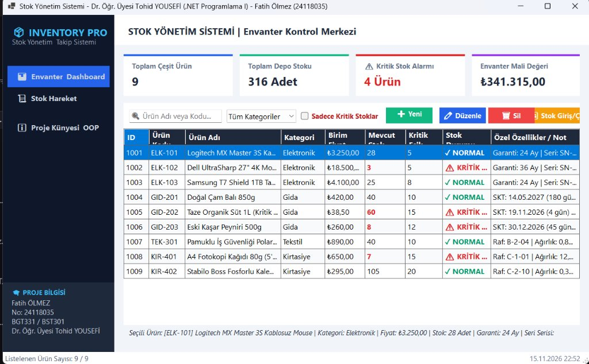
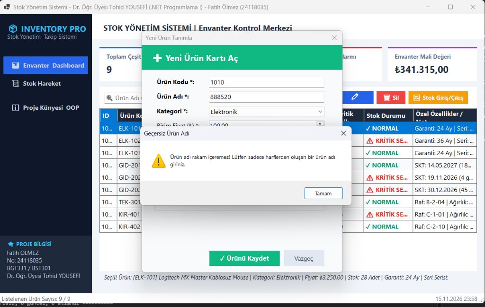
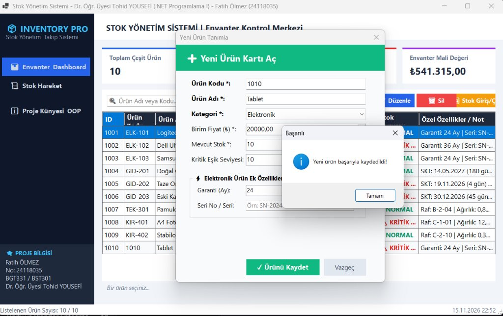
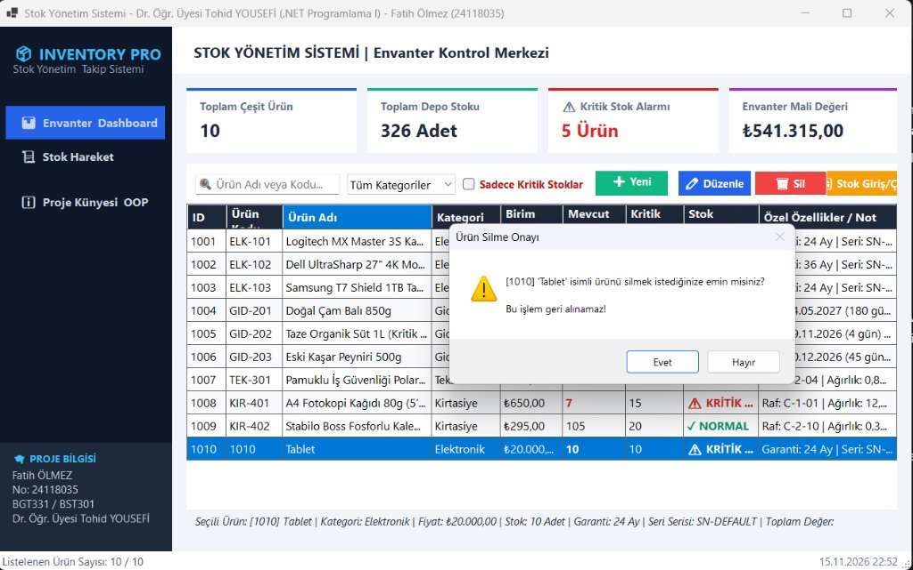
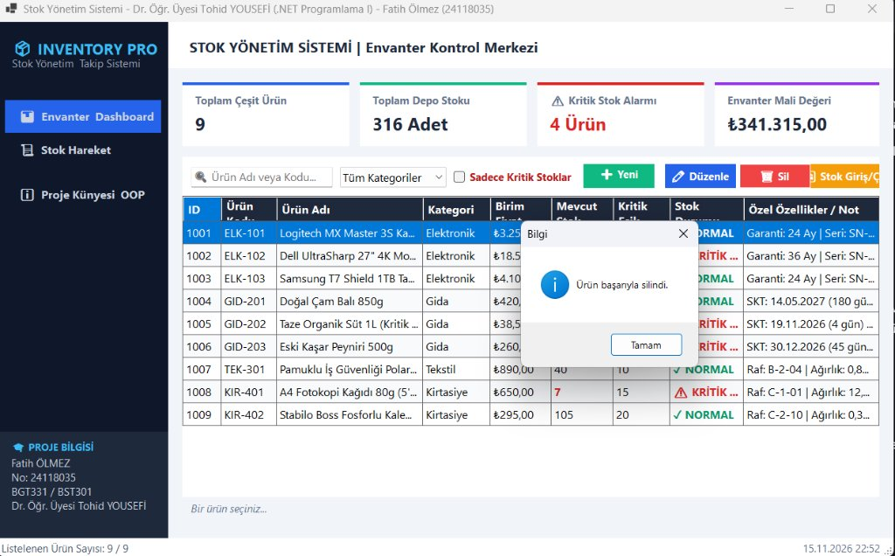

# Stok Yönetim Sistemi (Inventory Management System)
### .NET Programlama - I Dersi Proje Ödevi

* **Geliştirici:** Fatih ÖLMEZ (Öğrenci No: 24118035)
* **Ders:** .NET Programlama - I (BGT331 / BST301)
* **Öğretim Elemanı:** Dr. Öğr. Üyesi Tohid YOUSEFİ
* **Teslim Paketi:** `24118035_FatihOlmez_InventoryManagement.zip`

---

## 📸 Uygulama Ekran Görüntüleri

### 1. Ana Dashboard & Envanter Kontrol Merkezi

### 2. Hata Yönetimi ve Girdi Doğrulama (Rakam Girişi Uyarısı)

### 3. Yeni Ürün Tanımlama ve Başarılı Kayıt

### 4. Ürün Silme Onay Penceresi

### 5. Ürün Silme İşleminin Tamamlanması

---

## 📁 Paket İçeriği ve Dizin Yapısı

* **`01_SourceCode/`** : Visual Studio Çözümü (`InventoryManagement.sln`), proje dosyaları ve tüm C# kaynak kodları.
* **`02_Application/`** : Derlenmiş, kuruluma gerek olmadan doğrudan çift tıkla çalışan masaüstü uygulaması (`InventoryManagement.exe`).
* **`03_Report/`** : Şartnamedeki 13 ana başlığı ve ekran görüntülerini eksiksiz içeren kapsamlı Proje Raporu.
* **`04_GitHub/`** : GitHub repository README belgesi, ekran görüntüleri ve proje bağlantı açıklaması.
* **`screenshots/`** : Uygulama çalışma ekran görüntüleri klasörü.
* **`README.md`** : Kök dizin bilgilendirme ve hızlı başlangıç kılavuzu.

---

## ⚡ Hızlı Çalıştırma

1. **Uygulamayı Doğrudan Açmak İçin:**
   * `02_Application/InventoryManagement.exe` dosyasına çift tıklayınız.

2. **Visual Studio ile İncelemek İçin:**
   * `01_SourceCode/InventoryManagement.sln` dosyasını Visual Studio 2022 ile açıp `F5` tuşuna basınız.

---

## 🏆 Öne Çıkan Özellikler ve OOP Mimarisi
* **Modern Dashboard Tasarımı:** Canlı KPI kartları, anlık arama, renkli durum rozetleri ve modern sidebar menü.
* **Soyutlama (Abstraction):** `UrunBase` (abstract class), `IUrun`, `IStokIslemleri`, `ILoglanabilir` (interfaces).
* **Kalıtım (Inheritance):** `FizikselUrun`, `BozulabilirUrun`, `ElektronikUrun`.
* **Çok Biçimlilik (Polymorphism):** `KritikStokMu()`, `ToplamDegerHesapla()`, `DetayliBilgiGetir()`.
* **Kapsülleme (Encapsulation):** Özel alanlar ve korumalı özellikler.
* **Stok Hareket Denetim Günlüğü:** Gerçekleşen her işlem ayrıntılarıyla kaydedilir.
